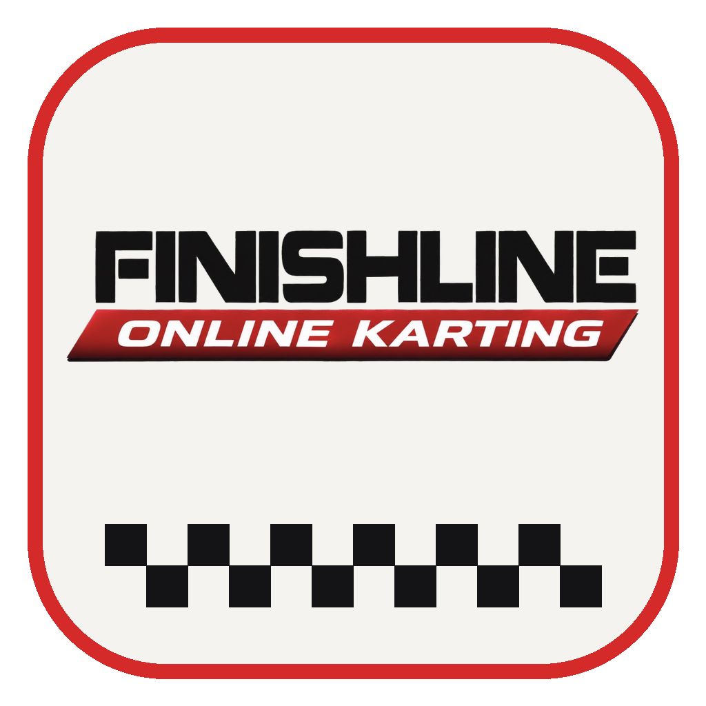

# Gridline Online Karting

A kart racing simulator of the circuit at Gridline Performance Karting in
Biloxi, Mississippi. Race against the clock, the AI or your friends online,
and join the weekly championship.

**Play in your browser:** https://ezl8016.github.io/gridline-online-karting/

## What's in it

- **Four layouts**, each clockwise or counter-clockwise: Tidal Turns, Cadet 206
  Practice, Karting Coastal and the Biloxi Fall Fling.
- **Four karts:** the rental R25, the LO206, the Vintage Kart and the KA100.
- **Online multiplayer:** up to 11 drivers on a server, with qualifying, races,
  AI drivers to fill the grid and voice chat.
- **Fastest Drivers:** worldwide lap time boards for every layout.
- **The Garage:** paint your kart, design your helmet and suit, and pick the
  music you hear on track.
- **The Shop:** spend the points you earn by driving on monthly skin sets and on
  music by The Marlo Boys and Adam Holt. You can preview a song first.
- **Time of day and weather:** afternoon, evening, overcast or night under the
  floodlights, dry or in the rain.
- **The clubhouse:** get out of your kart and walk around it with your friends.

## The championship

One season for everyone, on Saturdays at **8:00 pm Central**. Every race has 11
drivers: if there aren't 11 people, AI drivers take the empty seats and score
points too. Everyone drives the same kart each round.

| Round | Date | Track | Kart |
|---|---|---|---|
| 1 | Nov 7 | Tidal Turns | Rental Kart R25 |
| 2 | Nov 14 | Cadet 206 Practice | LO206 |
| 3 | Nov 21 | Tidal Turns (counter-clockwise) | LO206 |
| 4 | Dec 5 | Karting Coastal | LO206 |
| 5 | Dec 12 | Cadet 206 Practice (counter-clockwise) | KA100 |
| 6 | Dec 19 | Biloxi Fall Fling (night) | KA100 |

Sign in and open **Multiplayer**. The **Join** button opens 15 minutes before
the race, qualifying starts at 7:50, and the race starts at 8:00. Dates can
change, so the game always has the latest schedule.

Points go 25, 18, 15, 12, 10, 8, 6, 4, 2, 1, plus 1 for the fastest lap. If two
drivers tie on points, the better finishing positions decide it.

## Get it on your Dock or Start menu (easiest)

Open the game in your browser, then:

- **Mac (Safari):** **File → Add to Dock**.
- **Windows / Chromebook (Edge or Chrome):** the **Install** button at the
  right of the address bar (or menu → **Apps → Install this site as an app**).

It gets its own icon and window, with no security warnings, and always runs
the latest version.

## The desktop app

**The app downloads under Releases don't work right now,** because they still
open the game's old address. Please use the browser link above until this note
is gone. Your account, lap times and purchases are all safe.

## Controls

| | Keyboard | Gamepad |
|---|---|---|
| Throttle | W / ↑ | RT |
| Brake | S / ↓ / Space | LT |
| Steer | A D / ← → | Left stick |
| Camera | C | Y |
| Turn kart around | F | X |
| Reset to track | R | B |
| Menu | Esc | Start |
| Full screen (app) | F11 | |

Steering wheels and pedals work too: set them up under **Controls** in the game.
